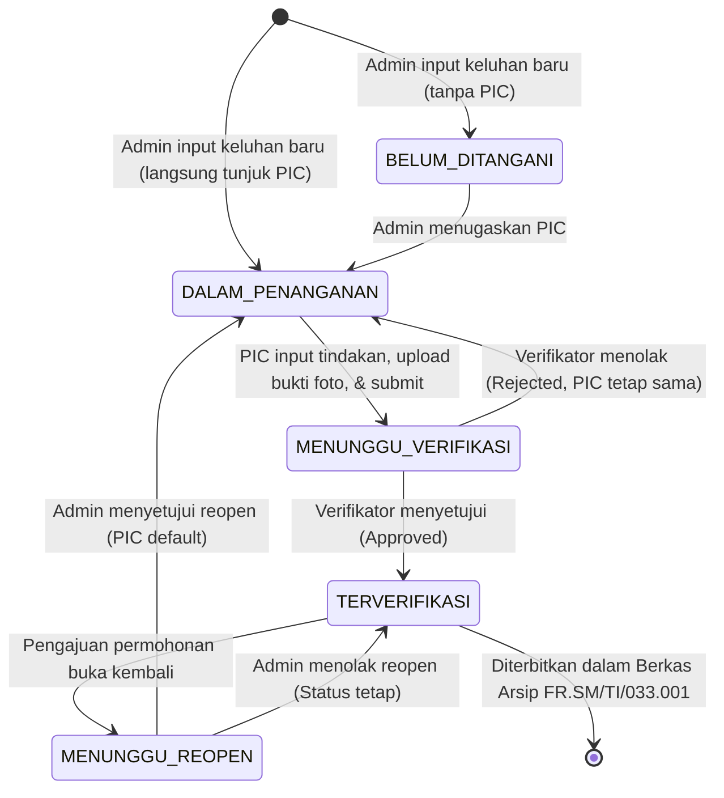

# SPKP - Sistem Penanganan Keluhan Pelanggan
**PT Kereta Api Indonesia (Persero)**

> **Sistem Informasi Pengendalian Mutu & Dokumentasi Tindak Lanjut Keluhan Pelanggan**  
> Formulir Standar Kendali Mutu: `FR.SM/TI/033.001`

---

## 📌 Ringkasan Proyek

**SPKP (Sistem Penanganan Keluhan Pelanggan)** adalah aplikasi web internal PT Kereta Api Indonesia (Persero) yang dirancang untuk mendokumentasikan, mengoordinasikan penugasan PIC operasional, mencatat tindakan perbaikan/pencegahan beserta bukti foto fisik lapangan, dan memverifikasi mutu penyelesaian keluhan pelanggan dari berbagai saluran resmi KAI (Access by KAI, Contact Center 121, Media Sosial, Loket Stasiun, dll).

Sistem ini menerapkan **Pemisahan Tiga Peran (*Three-Tier Role Separation*)** secara ketat, kepatuhan *Four-Eyes Principle* dalam pengendalian mutu, penerbitan dokumen rekapitulasi audit kebal ubah (*Immutable Snapshot*), pencetakan dan unduh PDF resmi berstandar KAI (`FR.SM/TI/033.001`), serta ekspor spreadsheet Excel seragam di seluruh role.

---

## 👥 Peran Pengguna (Roles & Responsibilities)

| Role | Identitas Aktor | Tanggung Jawab & Wewenang |
| :--- | :--- | :--- |
| **`ADMIN`** | Customer Service / Pengelola Sistem | • Mencatat registrasi keluhan baru yang masuk.<br>• **Menentukan penugasan PIC** dan mengelola data pokok registrasi.<br>• Memonitor overview dashboard operasional.<br>• Menyetujui atau menolak permohonan pembukaan kembali (*reopen*) keluhan dengan proteksi *Self-Approval Prevention*.<br>• Menerbitkan dokumen laporan resmi cetak/PDF (`FR.SM/TI/033.001`) dengan snapshot data beku.<br>• **Dilarang melakukan verifikasi mutu keluhan** (*Four-Eyes Principle*).<br>• **Dilarang menyimpan progres penanganan atas nama PIC** (*Separation of Duties*). |
| **`PIC`** | Petugas Lapangan / Unit Kerja Terkait | • Melihat seluruh keluhan yang ada di dalam sistem untuk transparansi operasional.<br>• Memiliki filter cepat **"Tugas Saya"**.<br>• **Hanya berwenang mengeksekusi keluhan yang ditugaskan kepada dirinya** (`picId === user.id`).<br>• Mendokumentasikan **Tindakan Perbaikan (*Corrective Action*)** dan **Tindakan Pencegahan (*Preventive Action*)**.<br>• **Mengunggah foto bukti hasil perbaikan lapangan ke Cloudinary** sebelum mengajukan verifikasi.<br>• Mengajukan hasil penanganan ke tahap verifikasi (*Submit for Verification*). |
| **`VERIFIKATOR`** | Tim Kendali Mutu / Quality Assurance | • Memeriksa keabsahan dan efektivitas tindakan penanganan serta foto bukti fisik lapangan dari PIC.<br>• **Pemegang wewenang eksklusif** untuk memberikan keputusan: **Disetujui (*Approved*)** atau **Ditolak (*Rejected*)**.<br>• Wajib menyertakan catatan evaluasi/alasan penolakan jika keluhan dikembalikan ke PIC untuk perbaikan ulang (*Rejection Loop*). |

---

## 🔄 Alur Status Keluhan (*Lifecycle State Machine*)



---

## 🛠️ Arsitektur & Teknologi Aktual

- **Frontend & App Framework:** [Next.js 14](https://nextjs.org/) (v14.2.15, App Router, Server Components & Server Actions)
- **UI Library & Styling:** [React 18](https://react.dev/), [Tailwind CSS v3](https://tailwindcss.com/)
- **Autentikasi & Keamanan:** [NextAuth.js v4](https://next-auth.js.org/) (Credentials Provider, Password Hash via `bcryptjs`, JWT Session, Protected Middleware)
- **Penyimpanan Berkas Foto Bukti:** [Cloudinary](https://cloudinary.com/) (Folder: `spkp-kai/proof-images`, upload via buffer stream, kompresi otomatis)
- **Database & ORM:** [MySQL](https://www.mysql.com/) (Database: `spkp_kai`) & [Prisma ORM v5](https://www.prisma.io/) (v5.22.0)
- **Dokumen & PDF Export:** [@react-pdf/renderer](https://react-pdf.org/) (Format presisi A4 Landscape standar KAI `FR.SM/TI/033.001`, Print & Unduh PDF langsung tanpa penerbitan ulang)
- **Excel Export:** [SheetJS (xlsx)](https://docs.sheetjs.com/) (Rekapitulasi spreadsheet operasional seragam di semua role dengan filter data kontekstual)
- **Pengujian (Testing):** [Vitest](https://vitest.dev/) (8 test suites, 127 skenario pengujian unit & integrasi untuk RBAC, State Machine, Snapshot Immutability, Reopen, dan Validasi)
- **Bahasa Pemrograman:** [TypeScript](https://www.typescriptlang.org/) (v5, Strict Mode)

---

## 📁 Struktur Direktori

```text
SPKP/
├── docs/                       # Dokumentasi spesifikasi & audit teknis
│   ├── aturan-bisnis.md        # Spesifikasi aturan bisnis resmi terkini
│   ├── state-machine.md        # Spesifikasi Finite State Machine (FSM)
│   ├── matriks-hak-akses.md    # Matriks RBAC 3 peran (Admin, PIC, Verifikator)
│   ├── arsitektur-skema-database.md # Spesifikasi skema database Prisma & MySQL
│   ├── laporan-pengujian-akhir.md   # Laporan audit pengujian & regresi komprehensif
│   └── audit-awal.md           # Laporan audit komprehensif historis
├── prisma/
│   ├── schema.prisma           # Skema database MySQL (User, Complaint, Verification, ReopenRequest, Document, AuditLog, Counter)
│   ├── seed.ts                 # Script seeding master data staf demo dan sample keluhan
│   └── migrations/             # Berkas migrasi database Prisma Migrate
├── scripts/
│   └── backup-db.ts            # Script backup pencadangan mandiri data ke JSON
├── src/
│   ├── app/
│   │   ├── actions/            # Next.js Server Actions (complaints.ts, auth.ts)
│   │   ├── api/
│   │   │   ├── auth/[...nextauth]/ # NextAuth Route Handler
│   │   │   └── upload/         # Route Handler upload foto bukti ke Cloudinary
│   │   ├── dashboard/          # Halaman portal utama sistem penanganan keluhan
│   │   ├── login/              # Halaman autentikasi kredensial staf KAI
│   │   ├── layout.tsx          # Root layout aplikasi
│   │   └── page.tsx            # Redirect rute landing
│   ├── components/             # Komponen UI (DashboardClient, KaiDocumentModal, KaiDocumentView, dll.)
│   │   ├── dashboard/          # Komponen dashboard modular (Table, Overview, ActionModal, DetailModal, CreateModal, DeleteModal)
│   │   └── pdf/                # Komponen renderer dokumen PDF resmi KAI (@react-pdf/renderer)
│   ├── lib/
│   │   ├── auth-options.ts     # Konfigurasi NextAuth (Credentials Provider & JWT callbacks)
│   │   ├── auth.ts             # Auth helpers (getCurrentUser, requireUser)
│   │   ├── cloudinary.ts       # Inisialisasi Cloudinary SDK
│   │   ├── complaintNumber.ts  # Generator nomor keluhan berurutan aman konkurensi
│   │   ├── exportExcel.ts      # Generator ekspor spreadsheet Excel (.xlsx) seragam
│   │   ├── permissions.ts      # Matriks hak akses & guard RBAC
│   │   ├── prisma.ts           # PrismaClient singleton
│   │   ├── state-machine.ts    # Validasi state machine keluhan
│   │   └── validation.ts       # Modul validasi form input
│   ├── middleware.ts           # Middleware proteksi rute aplikasi
│   └── types/                  # Definisi antarmuka TypeScript
├── tests/                      # Unit & integration test suites (8 files, 127 tests)
├── .env.example                # Template variabel lingkungan aktual
├── package.json
└── README.md
```
```

---

## 🚀 Panduan Memulai (Instalasi & Menjalankan Lokal)

### 1. Prasyarat Sistem
- Node.js versi 18.17+ atau 20+
- Database MySQL aktif (misalnya via XAMPP MySQL di port 3306)

### 2. Kloning & Instalasi Dependensi
```bash
git clone <repository-url>
cd spkp
npm install
```

### 3. Konfigurasi Lingkungan (`.env`)
Salin berkas template lingkungan:
```bash
cp .env.example .env
```
Pastikan variabel lingkungan pada `.env` telah disesuaikan:
```env
# Database MySQL Lokal
DATABASE_URL="mysql://root:@localhost:3306/spkp_kai"

# NextAuth.js
NEXTAUTH_URL="http://localhost:3000"
NEXTAUTH_SECRET="your-super-secret-key-32-chars-min"

# Cloudinary (Upload Foto Bukti Lapangan)
CLOUDINARY_CLOUD_NAME="your_cloud_name"
CLOUDINARY_API_KEY="your_api_key"
CLOUDINARY_API_SECRET="your_api_secret"
```

### 4. Migrasi Database & Seeding
Jalankan migrasi database Prisma dan pengisian data master/demo:
```bash
npx prisma migrate dev
npm run db:seed
```

### 5. Menjalankan Server Pengembangan
```bash
npm run dev
```
Buka browser dan akses: [http://localhost:3000](http://localhost:3000) (atau port yang aktif).

---

## 🔑 Akun Demo Pengujian

Setelah menjalankan script seed, akun berikut siap digunakan:

| Role | Email | Password | Kegunaan Uji Coba |
| :--- | :--- | :--- | :--- |
| **Admin / CS** | `admin@spkp.kai.id` | `password123` | Registrasi keluhan, penugasan PIC, reopen approval, cetak laporan PDF |
| **PIC Lapangan** | `pic@spkp.kai.id` | `password123` | Input tindakan perbaikan & pencegahan, upload foto bukti, submit verifikasi |
| **Verifikator** | `verifikator@spkp.kai.id` | `password123` | Tinjau hasil PIC & bukti foto, approve atau reject penanganan |

*(Halaman login telah dilengkapi tombol **Quick Fill** untuk pengujian instan antar-peran).*

---

## 🧪 Pengujian & Pengecekan Kualitas Kode

```bash
# Menjalankan seluruh unit test (Vitest)
npm test

# Pengecekan tipe statis (TypeScript)
npx tsc --noEmit

# Pengecekan linting kode (ESLint)
npm run lint

# Kompilasi produksi (Next.js Build)
npm run build
```
