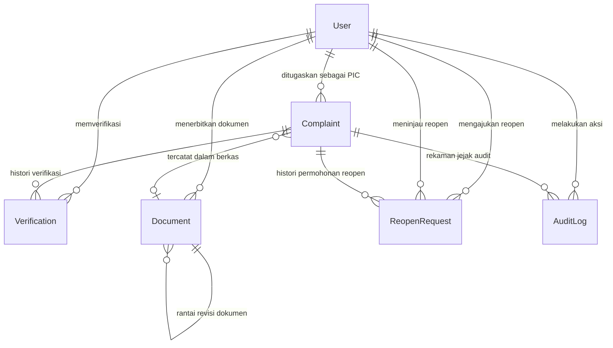

# Spesifikasi Arsitektur Skema Database — SPKP
**PT Kereta Api Indonesia (Persero)**

> **Versi Dokumen:** 3.0.0-Final  
> **Status:** Spesifikasi Skema Database Resmi (Disinkronkan)  
> **Tanggal:** 2026-10-20  
> **ORM & Database:** Prisma v5.22.0 / MySQL (InnoDB, `utf8mb4_unicode_ci`)

---

## 1. Ringkasan Desain Skema Database

Skema basis data SPKP dirancang untuk mendukung operasional penanganan keluhan pelanggan KAI dengan kepatuhan audit yang ketat, integritas relasional, dan performa tinggi:

1. **Penghapusan Menyeluruh Fitur SLA:** Model `SlaPolicy` dan seluruh bidang terkait SLA (`slaTargetHours`, `slaCalendarType`, `slaPolicyId`) telah dihapus secara menyeluruh dari skema basis data.
2. **Pencatatan Timestamp Operasional Presisi:** Membedakan waktu pelaporan penumpang (`date`), pencatatan sistem (`createdAt`), penugasan PIC (`assignedAt`), pengajuan verifikasi oleh PIC (`submittedAt`), dan persetujuan resmi verifikator (`completedAt`).
3. **Histori Siklus Verifikasi:** Pelacakan iterasi perbaikan (*rework round*) melalui bidang `cycle` pada model `Verification` jika terjadi penolakan.
4. **Model Entitas Terpisah `ReopenRequest`:** Menyimpan histori pengajuan pembukaan kembali keluhan terverifikasi, alasan pemohon, peninjauan Admin, dan catatan keputusan.
5. **Arsip Dokumen Kebal Ubah (*Immutable Snapshot*):** Model `Document` menyimpan salinan beku data keluhan dalam format JSON (`snapshotData`), nomor revisi (`revisionNumber`), dan relasi rantai revisi (`parentDocumentId`).
6. **Model `AuditLog`:** Mencatat seluruh rekaman aktivitas mutasi operasional (*who, what, when, entity, details*) tanpa menyimpan data sensitif.
7. **Penomoran Atomik Aman Konkurensi:** Model `ComplaintCounter` dan `DocumentCounter` untuk memastikan keunikan nomor registrasi keluhan (`CMP-YYYY-XXXX`) dan nomor dokumen audit KAI (`FR.SM/TI/033.001/MM-YYYY`) saat diakses banyak pengguna secara bersamaan.

---

## 2. Diagram Relasi Entitas (Entity-Relationship Diagram)



---

## 3. Spesifikasi Rinci Model Database

### 3.1 Model `User`
Menyimpan identitas staf internal KAI dengan kontrol peran tiga tingkat (*Three-Tier Roles*).

| Kolom | Tipe Data | Constraint / Default | Keterangan |
|:---|:---|:---|:---|
| `id` | VARCHAR(191) | PRIMARY KEY, UUID | Pengenal unik pengguna |
| `name` | VARCHAR(191) | NOT NULL | Nama lengkap staf |
| `email` | VARCHAR(191) | UNIQUE, NOT NULL | Alamat email resmi staf KAI |
| `password` | VARCHAR(191) | NOT NULL | Hash password via bcryptjs (10 rounds) |
| `role` | ENUM | DEFAULT 'PIC' | `ADMIN`, `PIC`, `VERIFIKATOR` |
| `createdAt` | DATETIME(3) | DEFAULT CURRENT_TIMESTAMP | Waktu pendaftaran akun |

*Indeks:* `User_email_key` (UNIQUE), `User_role_idx`.

---

### 3.2 Model `Complaint` (Data Pokok Keluhan)
Menyimpan seluruh data registrasi keluhan, penugasan PIC, tindakan perbaikan & pencegahan, URL foto bukti fisik, status siklus hidup, dan timestamp operasional.

| Kolom | Tipe Data | Constraint / Default | Keterangan |
|:---|:---|:---|:---|
| `id` | VARCHAR(191) | PRIMARY KEY, UUID | Pengenal unik keluhan |
| `complaintNumber` | VARCHAR(191) | UNIQUE, NOT NULL | Format resmi KAI: `CMP-YYYY-XXXX` |
| `date` | DATETIME(3) | NOT NULL | Tanggal/waktu pelaporan oleh penumpang |
| `customerName` | VARCHAR(191) | NOT NULL | Nama personil / pelapor keluhan |
| `customerContact` | VARCHAR(191) | NULL | Nomor kontak / WhatsApp pelapor |
| `daopOrStation` | VARCHAR(191) | NULL | Stasiun atau wilayah Daop operasional KAI |
| `source` | VARCHAR(191) | NOT NULL | Saluran masuk (Access by KAI, 121, dll.) |
| `category` | ENUM | NULL | Kategori keluhan (opsional klasifikasi KAI) |
| `description` | TEXT | NOT NULL | Uraian lengkap masalah dari pelapor |
| `status` | ENUM | DEFAULT 'BELUM_DITANGANI' | `BELUM_DITANGANI`, `DALAM_PENANGANAN`, `MENUNGGU_VERIFIKASI`, `TERVERIFIKASI` |
| `picId` | VARCHAR(191) | NULL, FK -> User | Petugas PIC yang ditugaskan (onDelete: SetNull) |
| `assignedAt` | DATETIME(3) | NULL | Waktu penugasan PIC oleh Admin |
| `submittedAt` | DATETIME(3) | NULL | Waktu pengajuan hasil verifikasi oleh PIC |
| `completedAt` | DATETIME(3) | NULL | Waktu resmi disetujui verifikator |
| `submissionCount`| INT | DEFAULT 0 | Jumlah putaran pengajuan oleh PIC |
| `correctiveAction`| TEXT | NULL | Tindakan perbaikan di lapangan |
| `preventiveAction`| TEXT | NULL | Tindakan pencegahan sistemik |
| `proofImageUrl` | TEXT | NULL | URL foto bukti fisik lapangan di Cloudinary |
| `notes` | TEXT | NULL | Catatan operasional |
| `documentId` | VARCHAR(191) | NULL, FK -> Document | Berkas dokumen penerbitan (onDelete: SetNull) |
| `createdAt` | DATETIME(3) | DEFAULT CURRENT_TIMESTAMP | Waktu pencatatan di sistem |
| `updatedAt` | DATETIME(3) | ON UPDATE | Waktu perubahan terakhir |

*Indeks:* `Complaint_complaintNumber_key` (UNIQUE), `Complaint_status_idx`, `Complaint_createdAt_idx`, `Complaint_category_idx`, `Complaint_status_picId_idx`.

---

### 3.3 Model `Verification` (Histori Keputusan Verifikasi)
Merekam seluruh riwayat keputusan verifikator mutu secara *append-only*.

| Kolom | Tipe Data | Constraint / Default | Keterangan |
|:---|:---|:---|:---|
| `id` | VARCHAR(191) | PRIMARY KEY, UUID | Pengenal unik verifikasi |
| `complaintId` | VARCHAR(191) | NOT NULL, FK -> Complaint | Keluhan terkait (onDelete: Cascade) |
| `verifierId` | VARCHAR(191) | NOT NULL, FK -> User | Verifikator penilai (onDelete: Restrict) |
| `result` | ENUM | NOT NULL | Keputusan: `APPROVED` atau `REJECTED` |
| `feedback` | TEXT | NULL | Kesimpulan verifikasi atau alasan perbaikan wajib |
| `cycle` | INT | DEFAULT 1 | Nomor putaran siklus pengajuan & verifikasi |
| `verifiedAt` | DATETIME(3) | DEFAULT CURRENT_TIMESTAMP | Waktu keputusan verifikasi dibuat |

*Indeks:* `Verification_complaintId_verifiedAt_idx`.

---

### 3.4 Model `ReopenRequest` (Permintaan Pembukaan Kembali)
Mengelola siklus pembukaan kembali tiket `TERVERIFIKASI` melalui persetujuan Admin bebas *self-approval*.

| Kolom | Tipe Data | Constraint / Default | Keterangan |
|:---|:---|:---|:---|
| `id` | VARCHAR(191) | PRIMARY KEY, UUID | Pengenal unik permohonan |
| `complaintId` | VARCHAR(191) | NOT NULL, FK -> Complaint | Keluhan terkait (onDelete: Restrict) |
| `requestedById` | VARCHAR(191) | NOT NULL, FK -> User | Pemohon buka kembali (onDelete: Restrict) |
| `reason` | TEXT | NOT NULL | Alasan rinci pembukaan kembali |
| `status` | ENUM | DEFAULT 'PENDING' | Status permohonan: `PENDING`, `APPROVED`, `REJECTED` |
| `reviewedById` | VARCHAR(191) | NULL, FK -> User | Admin peninjau (onDelete: SetNull) |
| `adminNotes` | TEXT | NULL | Catatan pertimbangan / alasan penolakan Admin |
| `requestedAt` | DATETIME(3) | DEFAULT CURRENT_TIMESTAMP | Waktu pengajuan permohonan |
| `reviewedAt` | DATETIME(3) | NULL | Waktu keputusan Admin |
| `createdAt` | DATETIME(3) | DEFAULT CURRENT_TIMESTAMP | Waktu pembuatan rekaman |
| `updatedAt` | DATETIME(3) | ON UPDATE | Waktu pembaruan terakhir |

*Indeks:* `ReopenRequest_complaintId_idx`, `ReopenRequest_status_idx`, `ReopenRequest_requestedAt_idx`.

---

### 3.5 Model `Document` (Arsip Rekapitulasi FR.SM/TI/033.001)
Menyimpan dokumen rekapitulasi audit mutu resmi KAI yang dikunci permanen (*immutable*).

| Kolom | Tipe Data | Constraint / Default | Keterangan |
|:---|:---|:---|:---|
| `id` | VARCHAR(191) | PRIMARY KEY, UUID | Pengenal unik dokumen |
| `documentNumber` | VARCHAR(191) | NOT NULL | Contoh: `FR.SM/TI/033.001/10-2026` |
| `version` | VARCHAR(191) | DEFAULT '002-2020' | Nomor standar formulir |
| `revisionNumber` | INT | DEFAULT 0 | Nomor revisi (0 = Master, 1 = Revisi 1, dst.) |
| `parentDocumentId`| VARCHAR(191) | NULL, FK -> Document | ID dokumen sebelumnya jika dokumen revisi |
| `revisionReason` | TEXT | NULL | Justifikasi jika melakukan revisi dokumen |
| `status` | ENUM | DEFAULT 'PUBLISHED' | `DRAFT`, `PUBLISHED`, `ARCHIVED`, `SUPERSEDED` |
| `documentDate` | DATETIME(3) | NOT NULL | Tanggal penetapan dokumen |
| `publishedAt` | DATETIME(3) | DEFAULT CURRENT_TIMESTAMP | Waktu resmi diterbitkan |
| `createdById` | VARCHAR(191) | NOT NULL, FK -> User | Admin pembuat dokumen (onDelete: Restrict) |
| `managementRep` | VARCHAR(191) | NOT NULL | Nama Management Representative pengesah |
| `snapshotData` | JSON | NULL | **Salinan Beku Seluruh Data Keluhan (Immutable)** |
| `totalComplaints` | INT | DEFAULT 0 | Total baris keluhan dalam dokumen |
| `createdAt` | DATETIME(3) | DEFAULT CURRENT_TIMESTAMP | Waktu pencatatan di database |
| `updatedAt` | DATETIME(3) | ON UPDATE | Waktu pembaruan terakhir |

*Indeks:* `Document_documentNumber_idx`, `Document_status_idx`, `Document_createdAt_idx`.

---

### 3.6 Model `AuditLog` (Jejak Rekaman Aktivitas Sistem)
Mencatat seluruh aksi operasional penting untuk kepatuhan tata kelola TI (*IT Governance*).

| Kolom | Tipe Data | Constraint / Default | Keterangan |
|:---|:---|:---|:---|
| `id` | VARCHAR(191) | PRIMARY KEY, UUID | Pengenal unik log aktivitas |
| `complaintId` | VARCHAR(191) | NULL, FK -> Complaint | Keluhan terkait (onDelete: SetNull) |
| `userId` | VARCHAR(191) | NULL, FK -> User | Pelaku aksi (onDelete: SetNull) |
| `action` | ENUM | NOT NULL | Aksi (`CREATE_COMPLAINT`, `ASSIGN_PIC`, dll.) |
| `entity` | VARCHAR(191) | DEFAULT 'Complaint' | Entitas target |
| `entityId` | VARCHAR(191) | NOT NULL | ID rekaman yang dimutasi |
| `details` | JSON | NULL | Metadata perubahan (tanpa password/kredensial) |
| `ipAddress` | VARCHAR(191) | NULL | Alamat IP klien (opsional) |
| `userAgent` | VARCHAR(191) | NULL | User agent peramban |
| `createdAt` | DATETIME(3) | DEFAULT CURRENT_TIMESTAMP | Waktu eksekusi aksi |

*Indeks:* `AuditLog_complaintId_createdAt_idx`, `AuditLog_userId_createdAt_idx`, `AuditLog_action_createdAt_idx`.

---

### 3.7 Model Konkurensi: `ComplaintCounter` & `DocumentCounter`
Tabel pengunci nomor berurutan atomik untuk mencegah duplikasi penomoran pada beban transaksi bersamaan.

```prisma
model ComplaintCounter {
  id           String   @id @default(uuid())
  year         Int      @unique
  lastSequence Int      @default(0)
  updatedAt    DateTime @updatedAt
}

model DocumentCounter {
  id           String   @id @default(uuid())
  year         Int
  month        Int
  lastSequence Int      @default(0)
  updatedAt    DateTime @updatedAt

  @@unique([year, month])
}
```

---

## 4. Siklus Timestamp Operasional & Audit Trail

Sistem melacak kronologi penanganan keluhan melalui 5 titik waktu operasional:

```text
[date: Waktu Kejadian/Laporan Penumpang]
       │
       ▼
[createdAt: Waktu Tiket Dicatat di Sistem oleh Admin]
       │
       ▼ (Admin menugaskan staf PIC)
[assignedAt: Waktu Tiket Mulai Ditugaskan ke PIC]
       │
       ▼ (PIC selesai penanganan & unggah foto bukti)
[submittedAt: Waktu Berkas Diserahkan ke Verifikator]
       │
       ▼ (Verifikator menyetujui APPROVED)
[completedAt: Waktu Keluhan Resmi Selesai & Terverifikasi]
```

Catatan:
* Jika hasil verifikasi ditolak (`REJECTED`), tiket kembali ke `DALAM_PENANGANAN`, `submittedAt` di-update saat diajukan ulang, dan `cycle` bertambah.
* Jika disetujui *reopen*, tiket kembali ke `DALAM_PENANGANAN` dan `completedAt` direset menjadi `null` hingga verifikasi ulang disetujui kembali.
