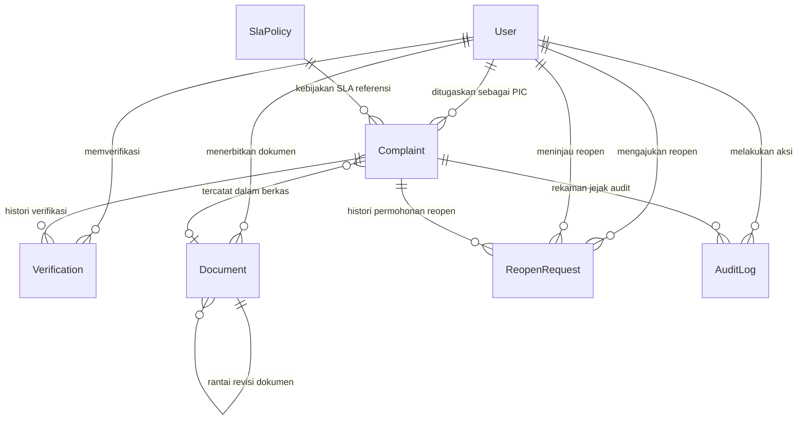

# Spesifikasi Arsitektur Skema Database — SPKP
**PT Kereta Api Indonesia (Persero)**

> **Versi Dokumen:** 2.0.0-Fase3  
> **Status:** Final Terverifikasi & Termigrasi  
> **Tanggal:** 2026-10-11  
> **ORM & Database:** Prisma v5.22.0 / MySQL (InnoDB, `utf8mb4_unicode_ci`)

---

## 1. Ringkasan Eksekutif Perubahan Skema (Fase 3)

Pada Fase 3, skema basis data telah diperluas dan dimigrasikan secara aman tanpa kehilangan data lama (*zero data loss*). Seluruh model kini mendukung penuh 6 pilar keputusan bisnis:

1. **Model Baru `SlaPolicy`:** Mengelola master target durasi SLA per kategori jenis keluhan beserta tipe kalender operasionalnya.
2. **Snapshot SLA pada `Complaint`:** Bidang `slaTargetHours` dan `slaCalendarType` dibekukan pada baris keluhan saat registrasi sehingga perubahan kebijakan di masa depan tidak mengubah perhitungan tiket historis.
3. **Pemisahan Timestamp Keluhan:** Membedakan waktu penugasan PIC (`assignedAt`), waktu pengajuan PIC (`submittedAt`), dan waktu keluhan resmi disetujui verifikator (`completedAt`).
4. **Histori Siklus Verifikasi:** Penambahan bidang `cycle` pada model `Verification` untuk melacak iterasi perbaikan (*rework round*) jika terjadi penolakan.
5. **Model Baru `ReopenRequest`:** Menyimpan histori lengkap pengajuan pembukaan kembali keluhan terverifikasi, alasan pemohon, peninjauan Admin, dan catatan keputusan.
6. **Arsip Dokumen Kebal Ubah (*Immutable Snapshot*):** Penambahan bidang `snapshotData (JSON)`, `revisionNumber`, dan rantai revisi dokumen `parentDocumentId` pada model `Document`.
7. **Model Baru `AuditLog`:** Mencatat seluruh rekaman aktivitas kritis (*who, what, when, details*) tanpa menyimpan informasi sensitif (password/token).
8. **Optimasi Kueri & Indeks:** Penambahan indeks komposit performa tinggi pada kueri filter status, PIC, dan kategori.

---

## 2. Diagram Relasi Entitas (Entity-Relationship Diagram)



---

## 3. Spesifikasi Rinci Model Database

### 3.1 Model `User`
Menyimpan identitas staf internal KAI dengan kontrol peran tiga tingkat (*Three-Tier Roles*).

| Kolom | Tipe Data | Constraint / Default | Keterangan |
|:---|:---|:---|:---|
| `id` | VARCHAR(191) | PRIMARY KEY, UUID | Pengenal unik pengguna |
| `name` | VARCHAR(191) | NOT NULL | Nama lengkap staf |
| `email` | VARCHAR(191) | UNIQUE, NOT NULL | Alamat email resmi KAI |
| `password` | VARCHAR(191) | NOT NULL | Hash password via bcryptjs (10 rounds) |
| `role` | ENUM | NOT NULL, DEFAULT 'PIC' | `ADMIN`, `PIC`, `VERIFIKATOR` |
| `createdAt` | DATETIME(3) | DEFAULT CURRENT_TIMESTAMP | Waktu pendaftaran akun |

*Indeks:* `User_email_key` (UNIQUE), `User_role_idx`.

---

### 3.2 Model `SlaPolicy` (Master Kebijakan SLA)
Menyimpan konfigurasi standar pelayanan minimal untuk setiap jenis keluhan.

| Kolom | Tipe Data | Constraint / Default | Keterangan |
|:---|:---|:---|:---|
| `id` | VARCHAR(191) | PRIMARY KEY, UUID | Pengenal unik kebijakan |
| `category` | ENUM | UNIQUE, NOT NULL | Kategori jenis keluhan |
| `name` | VARCHAR(191) | NOT NULL | Nama tampilan kategori (misal: "Keselamatan & Keamanan") |
| `targetHours` | INT | NOT NULL | Target waktu penyelesaian (satuan jam) |
| `calendarType` | ENUM | DEFAULT 'CALENDAR_24_7' | `CALENDAR_24_7` atau `BUSINESS_HOURS` |
| `description` | TEXT | NULL | Penjelasan cakupan masalah |
| `isActive` | BOOLEAN | DEFAULT true | Status keaktifan kebijakan |
| `createdAt` | DATETIME(3) | DEFAULT CURRENT_TIMESTAMP | Waktu pembuatan |
| `updatedAt` | DATETIME(3) | ON UPDATE | Waktu pembaruan konfigurasi |

*Indeks:* `SlaPolicy_category_key` (UNIQUE), `SlaPolicy_category_idx`, `SlaPolicy_isActive_idx`.

---

### 3.3 Model `Complaint` (Data Pokok Keluhan)
Menyimpan seluruh informasi keluhan, status siklus hidup, penugasan, snapshot SLA, dan catatan penanganan.

| Kolom | Tipe Data | Constraint / Default | Keterangan |
|:---|:---|:---|:---|
| `id` | VARCHAR(191) | PRIMARY KEY, UUID | Pengenal unik keluhan |
| `complaintNumber` | VARCHAR(191) | UNIQUE, NOT NULL | Format resmi KAI: `CMP-YYYY-XXXX` |
| `date` | DATETIME(3) | NOT NULL | Tanggal/waktu pelaporan oleh penumpang |
| `customerName` | VARCHAR(191) | NOT NULL | Nama pelapor / penumpang |
| `customerContact`| VARCHAR(191) | NULL | Kontak nomor telepon / WhatsApp |
| `daopOrStation` | VARCHAR(191) | NULL | Stasiun atau wilayah Daop operasional |
| `source` | VARCHAR(191) | NOT NULL | Saluran masuk keluhan (Access by KAI, 121, dll) |
| `category` | ENUM | NULL | Kategori keluhan (K-1 s.d K-7) |
| `description` | TEXT | NOT NULL | Uraian lengkap masalah dari pelapor |
| `status` | ENUM | DEFAULT 'BELUM_DITANGANI'| `BELUM_DITANGANI`, `DALAM_PENANGANAN`, `MENUNGGU_VERIFIKASI`, `TERVERIFIKASI` |
| `picId` | VARCHAR(191) | NULL, FK -> User | Petugas PIC yang ditugaskan (onDelete: SetNull) |
| `assignedAt` | DATETIME(3) | NULL | Waktu penugasan PIC oleh Admin |
| `submittedAt` | DATETIME(3) | NULL | Waktu PIC mengajukan hasil ke Verifikator |
| `completedAt` | DATETIME(3) | NULL | Waktu keluhan disetujui (resmi selesai) |
| `submissionCount`| INT | DEFAULT 0 | Jumlah putaran pengajuan oleh PIC |
| `slaTargetHours` | INT | NULL | **Snapshot Target Jam SLA** (kebal perubahan master) |
| `slaCalendarType`| ENUM | DEFAULT 'CALENDAR_24_7' | **Snapshot Kalender SLA** |
| `slaPolicyId` | VARCHAR(191) | NULL, FK -> SlaPolicy | Relasi referensi ke master kebijakan (onDelete: SetNull) |
| `correctiveAction`| TEXT | NULL | Tindakan perbaikan di lapangan |
| `preventiveAction`| TEXT | NULL | Tindakan pencegahan sistemik |
| `proofImageUrl` | TEXT | NULL | URL publik foto bukti di Cloudinary |
| `notes` | TEXT | NULL | Catatan pelaksanaan operasional |
| `documentId` | VARCHAR(191) | NULL, FK -> Document | Berkas dokumen penerbitan (onDelete: SetNull) |
| `createdAt` | DATETIME(3) | DEFAULT CURRENT_TIMESTAMP | Waktu pencatatan keluhan di sistem |
| `updatedAt` | DATETIME(3) | ON UPDATE | Waktu perubahan terakhir |

*Indeks:* `Complaint_complaintNumber_key` (UNIQUE), `Complaint_status_idx`, `Complaint_createdAt_idx`, `Complaint_category_idx`, `Complaint_status_picId_idx`.

---

### 3.4 Model `Verification` (Histori Keputusan Verifikasi)
Merekam jejak keputusan verifikator mutu secara *append-only* (tidak boleh ditimpa).

| Kolom | Tipe Data | Constraint / Default | Keterangan |
|:---|:---|:---|:---|
| `id` | VARCHAR(191) | PRIMARY KEY, UUID | Pengenal unik verifikasi |
| `complaintId` | VARCHAR(191) | NOT NULL, FK -> Complaint | Keluhan terkait (onDelete: Cascade) |
| `verifierId` | VARCHAR(191) | NOT NULL, FK -> User | Verifikator penilai (onDelete: Restrict) |
| `result` | ENUM | NOT NULL | Keputusan: `APPROVED` atau `REJECTED` |
| `feedback` | TEXT | NULL | Kesimpulan atau alasan perbaikan wajib |
| `cycle` | INT | DEFAULT 1 | Nomor siklus/putaran verifikasi (1, 2, dst) |
| `verifiedAt` | DATETIME(3) | DEFAULT CURRENT_TIMESTAMP | Waktu keputusan verifikasi dibuat |

*Indeks:* `Verification_complaintId_verifiedAt_idx`.

---

### 3.5 Model `ReopenRequest` (Permintaan Pembukaan Kembali)
Mengelola siklus pembukaan kembali tiket yang sudah `TERVERIFIKASI` melalui persetujuan Admin.

| Kolom | Tipe Data | Constraint / Default | Keterangan |
|:---|:---|:---|:---|
| `id` | VARCHAR(191) | PRIMARY KEY, UUID | Pengenal unik permohonan |
| `complaintId` | VARCHAR(191) | NOT NULL, FK -> Complaint | Keluhan yang diminta buka (onDelete: Restrict) |
| `requestedById` | VARCHAR(191) | NOT NULL, FK -> User | Pemohon buka kembali (onDelete: Restrict) |
| `reason` | TEXT | NOT NULL | Alasan rinci pembukaan kembali |
| `status` | ENUM | DEFAULT 'PENDING' | Status permohonan: `PENDING`, `APPROVED`, `REJECTED` |
| `reviewedById` | VARCHAR(191) | NULL, FK -> User | Admin yang meninjau (onDelete: SetNull) |
| `adminNotes` | TEXT | NULL | Catatan pertimbangan/alasan penolakan Admin |
| `requestedAt` | DATETIME(3) | DEFAULT CURRENT_TIMESTAMP | Waktu pengajuan permohonan |
| `reviewedAt` | DATETIME(3) | NULL | Waktu Admin memutuskan |
| `createdAt` | DATETIME(3) | DEFAULT CURRENT_TIMESTAMP | Waktu rekaman dibuat |
| `updatedAt` | DATETIME(3) | ON UPDATE | Waktu mutasi terakhir |

*Indeks:* `ReopenRequest_complaintId_idx`, `ReopenRequest_status_idx`, `ReopenRequest_requestedAt_idx`.

---

### 3.6 Model `Document` (Arsip Rekapitulasi FR.SM/TI/033.001)
Menyimpan dokumen rekapitulasi audit resmi berformat ISO/KAI yang dikunci permanen (*immutable*).

| Kolom | Tipe Data | Constraint / Default | Keterangan |
|:---|:---|:---|:---|
| `id` | VARCHAR(191) | PRIMARY KEY, UUID | Pengenal unik dokumen |
| `documentNumber` | VARCHAR(191) | NOT NULL | Contoh: `FR.SM/TI/033.001/10-2020` |
| `version` | VARCHAR(191) | DEFAULT '002-2020' | Nomor standar formulir |
| `revisionNumber` | INT | DEFAULT 0 | Nomor revisi (0 = Master Dokumen Asli) |
| `parentDocumentId`| VARCHAR(191) | NULL, FK -> Document | ID dokumen sebelumnya jika ini dokumen revisi |
| `revisionReason` | TEXT | NULL | Justifikasi jika melakukan revisi dokumen lama |
| `status` | ENUM | DEFAULT 'PUBLISHED' | `DRAFT`, `PUBLISHED`, `ARCHIVED`, `SUPERSEDED` |
| `documentDate` | DATETIME(3) | NOT NULL | Tanggal pengesahan dokumen |
| `publishedAt` | DATETIME(3) | DEFAULT CURRENT_TIMESTAMP | Timestamp resmi saat diterbitkan |
| `createdById` | VARCHAR(191) | NOT NULL, FK -> User | Admin pembuat dokumen (onDelete: Restrict) |
| `managementRep` | VARCHAR(191) | NOT NULL | Nama Management Representative pengesah |
| `snapshotData` | JSON | NULL | **Salinan Beku Seluruh Data Keluhan (Immutable)** |
| `totalComplaints` | INT | DEFAULT 0 | Jumlah baris keluhan dalam dokumen |
| `createdAt` | DATETIME(3) | DEFAULT CURRENT_TIMESTAMP | Waktu pembuatan di database |
| `updatedAt` | DATETIME(3) | DEFAULT CURRENT_TIMESTAMP | Waktu pembaruan terakhir |

*Indeks:* `Document_documentNumber_idx`, `Document_status_idx`, `Document_createdAt_idx`.

---

### 3.7 Model `AuditLog` (Jejak Rekaman Aktivitas Sistem)
Mencatat seluruh mutasi operasional penting untuk kepatuhan tata kelola TI (*IT Governance*).

| Kolom | Tipe Data | Constraint / Default | Keterangan |
|:---|:---|:---|:---|
| `id` | VARCHAR(191) | PRIMARY KEY, UUID | Pengenal unik rekaman log |
| `complaintId` | VARCHAR(191) | NULL, FK -> Complaint | Keluhan yang dipengaruhi (onDelete: SetNull) |
| `userId` | VARCHAR(191) | NULL, FK -> User | Pengguna pelaku aksi (onDelete: SetNull) |
| `action` | ENUM | NOT NULL | Aksi operasional (`ASSIGN_PIC`, `VERIFY_APPROVED`, dll) |
| `entity` | VARCHAR(191) | DEFAULT 'Complaint' | Entitas target |
| `entityId` | VARCHAR(191) | NOT NULL | ID rekaman yang dimutasi |
| `details` | JSON | NULL | Metadata perubahan (tanpa password/kredensial) |
| `ipAddress` | VARCHAR(191) | NULL | Alamat IP klien (opsional) |
| `userAgent` | VARCHAR(191) | NULL | Peramban / agen pengguna |
| `createdAt` | DATETIME(3) | DEFAULT CURRENT_TIMESTAMP | Waktu eksekusi aksi |

*Indeks:* `AuditLog_complaintId_createdAt_idx`, `AuditLog_userId_createdAt_idx`, `AuditLog_action_createdAt_idx`.

---

## 4. Siklus Timestamp dan Perhitungan SLA

Untuk menjamin akurasi pelaporan, sistem menggunakan 5 titik waktu pada keluhan:

```text
[date / Waktu Pelaporan Pelanggan]
       │
       ▼
[createdAt / Waktu Tiket Masuk Sistem] ────► [Titik Awal SLA Total]
       │
       ▼ (Admin menugaskan PIC)
[assignedAt / Waktu Penugasan PIC]    ────► [Titik Awal SLA PIC]
       │
       ▼ (PIC selesai & upload bukti foto)
[submittedAt / Waktu Pengajuan PIC]   ────► [Titik Akhir SLA PIC]
       │
       ▼ (Verifikator menyetujui APPROVED)
[completedAt / Waktu Tiket Selesai]   ────► [Titik Akhir SLA Total]
```

* **SLA Penanganan PIC:** `submittedAt - assignedAt`
* **SLA Total Pelayanan:** `completedAt - createdAt`
* **Keamanan Historis:** Perhitungan selalu menggunakan `complaint.slaTargetHours` dan `complaint.slaCalendarType` yang tersimpan pada baris keluhan, bukan membaca dinamis dari tabel master `SlaPolicy`.

---

## 5. Bukti Eksekusi Migrasi & Integritas Data

Migrasi telah diterapkan ke database `spkp_kai` pada lingkungan pengembangan:
* **Migration Name:** `20261011140448_enhance_spkp_models_fase3`
* **Status Migrasi:** Sukses diterapkan via `npx prisma migrate dev`.
* **Prisma Client:** Berhasil ter-generate ulang (`@prisma/client v5.22.0`).
* **Verifikasi Data Riil:**
  * Total Keluhan Sebelum: **3** → Total Sesudah: **3** (100% Utuh)
  * Total Pengguna Sebelum: **3** → Total Sesudah: **3** (100% Utuh)
  * Total Dokumen Sebelum: **16** → Total Sesudah: **16** (100% Utuh)
  * Master SLA Policy Ditambahkan: **7 Kebijakan Standar**
* **Kompilasi TypeScript:** `npx tsc --noEmit` lolos tanpa error (**0 errors**).
* **Next.js Production Build:** `npm run build` sukses (**7/7 routes compiled**).
