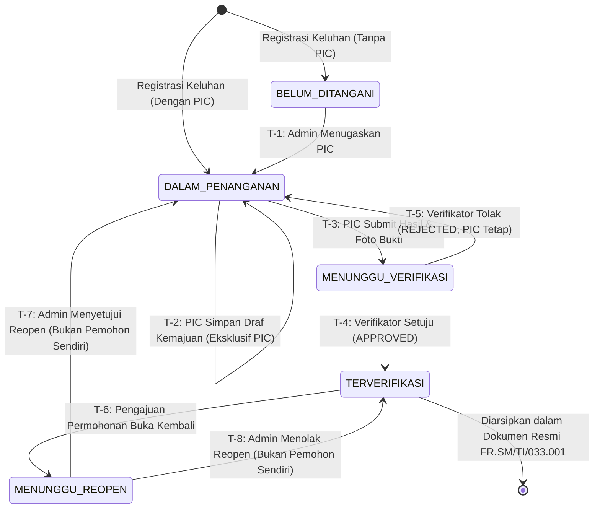

# Spesifikasi Finite State Machine (FSM) Keluhan SPKP
**PT Kereta Api Indonesia (Persero)**

> **Versi Dokumen:** 3.0.0-Final  
> **Status:** Spesifikasi State Machine Resmi (Disinkronkan)  
> **Tanggal:** 2026-10-20  
> **Tujuan:** Menetapkan seluruh transisi status yang sah, aturan guard, payload validasi, mutasi timestamp operasional, jejak audit, serta menangkal transisi ilegal dari input klien.

---

## 1. Diagram Alur Siklus Hidup Keluhan (Mermaid FSM)

---

## 2. Arsitektur Reopen: Entitas Terpisah (`ReopenRequest` Model)

Siklus **Permintaan Pembukaan Kembali (Reopen Request)** dimodelkan secara terpisah menggunakan entitas `ReopenRequest`:
* **Integritas Status Pokok:** Enum `ComplaintStatus` tetap bersih 4 status: `BELUM_DITANGANI`, `DALAM_PENANGANAN`, `MENUNGGU_VERIFIKASI`, `TERVERIFIKASI`.
* **Histori Audit Penuh:** Setiap permohonan tersimpan sebagai rekaman tersendiri (alasan pemohon, timestamp, peninjau Admin, catatan keputusan).
* **Four-Eyes Principle / Self-Approval Prevention:** Jika Admin mengajukan reopen, sistem memblokir Admin tersebut untuk menyetujui atau menolak permohonannya sendiri. Peninjauan harus dilakukan oleh Admin lain.
* **Proteksi Atomik Konkurensi:** Pemeriksaan status `PENDING` dijalankan di dalam transaksi database sebelum keputusan dieksekusi untuk mencegah *race condition* antar-peninjau.

---

## 3. Matriks Detail Transisi State Machine

Setiap transisi status diwajibkan melewati proteksi Server Action di backend dan dilarang keras diubah secara langsung oleh payload klien (*tamper-proof*).

---

### Transisi T-1: Penugasan PIC Awal
* **Status Awal:** `BELUM_DITANGANI`
* **Status Tujuan:** `DALAM_PENANGANAN`
* **Role yang Diizinkan:** Hanya `ADMIN`
* **Validasi Prasyarat:**
  * Keluhan terdaftar di sistem dan saat ini belum memiliki PIC (`picId === null`).
  * `targetPicId` harus valid, merujuk pada pengguna yang terdaftar dengan role `PIC` atau `ADMIN`.
* **Data yang Harus Diisi:** `picId: string`
* **Timestamp yang Dimutakhirkan:** `assignedAt = now()`, `updatedAt = now()`
* **Audit Trail / Riwayat:** Aksi `ASSIGN_PIC` tercatat di `AuditLog`.
* **Kode & Pesan Error:**
  * `403 FORBIDDEN`: `"Hanya Admin yang berwenang menentukan penugasan PIC."`
  * `400 BAD_REQUEST`: `"Petugas PIC yang dipilih tidak valid atau tidak aktif."`
  * `409 CONFLICT`: `"Status keluhan saat ini tidak mengizinkan penugasan awal (harus BELUM_DITANGANI)."`

---

### Transisi T-2: Penyimpanan Draf Kemajuan Penanganan
* **Status Awal:** `DALAM_PENANGANAN`
* **Status Tujuan:** `DALAM_PENANGANAN` (status tidak berubah)
* **Role yang Diizinkan:** **Eksklusif `PIC` yang ditugaskan** (`complaint.picId === user.id`). Admin **DILARANG** override (*Separation of Duties*).
* **Validasi Prasyarat:**
  * Minimal salah satu dari tindakan perbaikan (`correctiveAction`), tindakan pencegahan (`preventiveAction`), catatan (`notes`), atau URL foto (`proofImageUrl`) terisi.
* **Data yang Dimutakhirkan:** Bidang tindakan yang diisi disimpan secara parsial (*autosave/draft*).
* **Timestamp yang Dimutakhirkan:** `updatedAt = now()`
* **Audit Trail / Riwayat:** Aksi `SAVE_PROGRESS` tercatat di `AuditLog`.
* **Kode & Pesan Error:**
  * `403 FORBIDDEN`: `"Hanya petugas PIC yang berwenang menyimpan progres penanganan."`
  * `403 FORBIDDEN`: `"Akses ditolak. Anda hanya berwenang mengeksekusi keluhan yang ditugaskan kepada Anda."`
  * `400 BAD_REQUEST`: `"Formulir tindakan penanganan tidak boleh kosong."`

---

### Transisi T-3: Pengajuan Hasil Penanganan untuk Verifikasi
* **Status Awal:** `DALAM_PENANGANAN`
* **Status Tujuan:** `MENUNGGU_VERIFIKASI`
* **Role yang Diizinkan:** **Eksklusif `PIC` yang ditugaskan** (`complaint.picId === user.id`). Admin **DILARANG** submit atas nama PIC.
* **Validasi Prasyarat:**
  1. `correctiveAction` wajib diisi minimal 5 karakter.
  2. `preventiveAction` wajib diisi minimal 5 karakter.
  3. `proofImageUrl` wajib terisi (URL foto bukti fisik Cloudinary yang valid).
* **Data yang Harus Diisi:** Payload penanganan lengkap beserta foto bukti.
* **Timestamp yang Dimutakhirkan:**
  * `submittedAt = now()` (titik waktu penyerahan berkas ke Verifikator)
  * `updatedAt = now()`
  * `submissionCount += 1`
* **Audit Trail / Riwayat:** Aksi `SUBMIT_VERIFICATION` tercatat di `AuditLog`.
* **Kode & Pesan Error:**
  * `403 FORBIDDEN`: `"Akses ditolak. Anda tidak berhak mengajukan verifikasi untuk keluhan ini."`
  * `422 UNPROCESSABLE_ENTITY`: `"Tindakan perbaikan, pencegahan, dan foto bukti lapangan wajib lengkap sebelum diajukan ke verifikator."`
  * `409 CONFLICT`: `"Keluhan tidak berada dalam status DALAM_PENANGANAN."`

---

### Transisi T-4: Verifikator Menyetujui Hasil Penanganan (APPROVED)
* **Status Awal:** `MENUNGGU_VERIFIKASI`
* **Status Tujuan:** `TERVERIFIKASI`
* **Role yang Diizinkan:** Mutlak hanya `VERIFIKATOR` (Admin dan PIC dilarang keras).
* **Validasi Prasyarat:**
  * Keluhan wajib sedang dalam status `MENUNGGU_VERIFIKASI`.
  * Verifikator wajib menginput kesimpulan hasil verifikasi (`feedback`).
* **Data yang Harus Diisi:**
  * `result: "APPROVED"`
  * `feedback: string`
* **Timestamp yang Dimutakhirkan:**
  * `completedAt = now()`
  * `updatedAt = now()`
  * `Verification.verifiedAt = now()`
* **Audit Trail / Riwayat:** Baris baru dibuat di tabel `Verification` dan aksi `VERIFY_APPROVED` dicatat di `AuditLog`.
* **Kode & Pesan Error:**
  * `403 FORBIDDEN`: `"Hanya Verifikator yang berwenang melakukan verifikasi mutu keluhan (SOP KAI four-eyes principle)."`
  * `409 CONFLICT`: `"Keluhan belum diajukan oleh PIC atau sudah tidak dalam status MENUNGGU_VERIFIKASI."`

---

### Transisi T-5: Verifikator Menolak Hasil Penanganan (REJECTED)
* **Status Awal:** `MENUNGGU_VERIFIKASI`
* **Status Tujuan:** `DALAM_PENANGANAN`
* **Role yang Diizinkan:** Mutlak hanya `VERIFIKATOR` (Admin dan PIC dilarang keras).
* **Validasi Prasyarat:**
  * Keluhan wajib sedang dalam status `MENUNGGU_VERIFIKASI`.
  * Alasan penolakan (`feedback`) wajib diisi secara rinci menjelaskan apa yang harus diperbaiki PIC.
* **Data yang Dimutakhirkan:**
  * `status = DALAM_PENANGANAN`
  * `picId` **TETAP SAMA** (tidak diubah atau dikosongkan).
  * Catatan tindakan PIC sebelumnya **TIDAK DIHAPUS** (agar PIC dapat menyempurnakan, bukan mengetik ulang).
* **Timestamp yang Dimutakhirkan:**
  * `updatedAt = now()`
  * `Verification.verifiedAt = now()`
* **Audit Trail / Riwayat:** Baris baru dibuat di tabel `Verification` (`result: 'REJECTED'`) dan aksi `VERIFY_REJECTED` dicatat di `AuditLog`.
* **Kode & Pesan Error:**
  * `403 FORBIDDEN`: `"Hanya Verifikator yang berwenang menolak verifikasi keluhan."`
  * `422 UNPROCESSABLE_ENTITY`: `"Alasan penolakan dan instruksi perbaikan wajib diisi."`
  * `409 CONFLICT`: `"Keluhan tidak dalam status MENUNGGU_VERIFIKASI."`

---

### Transisi T-6: Pengajuan Permohonan Pembukaan Kembali (Reopen Request)
* **Status Awal:** `TERVERIFIKASI`
* **Status Operasional:** Status keluhan tetap `TERVERIFIKASI` dengan entitas `ReopenRequest (status: PENDING)`.
* **Role yang Diizinkan:** `ADMIN` dan `VERIFIKATOR`
* **Validasi Prasyarat:**
  * Keluhan wajib sudah berstatus `TERVERIFIKASI`.
  * Tidak sedang memiliki permohonan reopen lain yang masih berstatus pending.
  * Alasan pembukaan kembali (`reason`) wajib diisi (minimal 10 karakter).
* **Data yang Harus Diisi:** `complaintId`, `reason`, `requestedById: user.id`
* **Timestamp yang Dimutakhirkan:** `ReopenRequest.requestedAt = now()`
* **Audit Trail / Riwayat:** Aksi `REQUEST_REOPEN` dicatat di `AuditLog`.
* **Kode & Pesan Error:**
  * `400 BAD_REQUEST`: `"Alasan pembukaan kembali keluhan minimal 10 karakter."`
  * `409 CONFLICT`: `"Hanya keluhan yang telah TERVERIFIKASI yang dapat diajukan untuk dibuka kembali."`
  * `409 CONFLICT`: `"Keluhan ini sudah memiliki permohonan reopen yang sedang menunggu peninjauan."`

---

### Transisi T-7: Admin Menyetujui Pembukaan Kembali Keluhan
* **Status Awal:** `TERVERIFIKASI` (dengan permohonan reopen pending)
* **Status Tujuan:** `DALAM_PENANGANAN`
* **Role yang Diizinkan:** Hanya `ADMIN` **yang bukan pemohon reopen** (`reopenReq.requestedById !== user.id`).
* **Validasi Prasyarat:**
  * Terdapat permohonan reopen berstatus `PENDING`.
  * Admin peninjau bukan pemohon sendiri (*Self-Approval Prevention*).
  * Catatan persetujuan Admin wajib diisi.
* **Data yang Dimutakhirkan:**
  * `status = DALAM_PENANGANAN`
  * `completedAt = null` (reset waktu penyelesaian)
  * `picId` **TETAP SAMA** (retensi PIC penanggung jawab)
  * `ReopenRequest.status = 'APPROVED'`
  * `ReopenRequest.reviewedById = user.id`
  * `ReopenRequest.reviewedAt = now()`
* **Timestamp yang Dimutakhirkan:** `updatedAt = now()`
* **Audit Trail / Riwayat:** Aksi `APPROVE_REOPEN` dicatat di `AuditLog`.
* **Kode & Pesan Error:**
  * `403 FORBIDDEN`: `"Pemohon tidak dapat menyetujui atau menolak permohonan reopen yang diajukan oleh dirinya sendiri."`
  * `409 CONFLICT`: `"Permohonan reopen ini sudah diproses sebelumnya."`

---

### Transisi T-8: Admin Menolak Pembukaan Kembali Keluhan
* **Status Awal:** `TERVERIFIKASI` (dengan permohonan reopen pending)
* **Status Tujuan:** `TERVERIFIKASI` (status tetap selesai)
* **Role yang Diizinkan:** Hanya `ADMIN` **yang bukan pemohon reopen** (`reopenReq.requestedById !== user.id`).
* **Validasi Prasyarat:**
  * Terdapat permohonan reopen berstatus `PENDING`.
  * Admin peninjau bukan pemohon sendiri (*Self-Approval Prevention*).
  * Alasan penolakan wajib diisi.
* **Data yang Dimutakhirkan:**
  * `status = TERVERIFIKASI` (tetap terkunci)
  * `ReopenRequest.status = 'REJECTED'`
  * `ReopenRequest.reviewedById = user.id`
  * `ReopenRequest.reviewedAt = now()`
  * `ReopenRequest.adminNotes = string`
* **Timestamp yang Dimutakhirkan:** `updatedAt = now()`
* **Audit Trail / Riwayat:** Aksi `REJECT_REOPEN` dicatat di `AuditLog`.

---

## 4. Matriks Transisi Ringkas (State Transition Table)

| Status Asal | Aksi / Event | Role Pelaksana | Status Tujuan | Guard & Validasi Kunci |
|:---|:---|:---|:---|:---|
| **BELUM_DITANGANI** | Tugaskan PIC | `ADMIN` | `DALAM_PENANGANAN` | `picId` valid |
| **DALAM_PENANGANAN** | Simpan Draf | `PIC` (Assigned) | `DALAM_PENANGANAN` | Minimal 1 data tindakan terisi, Admin dilarang |
| **DALAM_PENANGANAN** | Ajukan Verifikasi | `PIC` (Assigned) | `MENUNGGU_VERIFIKASI` | Corrective + Preventive + Foto Bukti lengkap |
| **MENUNGGU_VERIFIKASI** | Setujui Penanganan | `VERIFIKATOR` | `TERVERIFIKASI` | Feedback persetujuan wajib diisi, Admin dilarang |
| **MENUNGGU_VERIFIKASI** | Tolak Penanganan | `VERIFIKATOR` | `DALAM_PENANGANAN` | Feedback penolakan wajib, PIC tetap |
| **TERVERIFIKASI** | Ajukan Reopen | `ADMIN` / `VERIFIKATOR` | `TERVERIFIKASI` (*Pending*) | Status TERVERIFIKASI, alasan &ge; 10 char |
| *Pending Reopen* | Setujui Reopen | `ADMIN` (Bukan Pemohon) | `DALAM_PENANGANAN` | Retensi PIC, completedAt reset |
| *Pending Reopen* | Tolak Reopen | `ADMIN` (Bukan Pemohon) | `TERVERIFIKASI` | Alasan penolakan wajib diisi |

---

## 5. Larangan Transisi Ilegal (Invariants & Anti-Patterns)

1. **Dilarang Self-Verification:** PIC dilarang mengubah status dari `MENUNGGU_VERIFIKASI` ke `TERVERIFIKASI`.
2. **Dilarang Admin-Verification:** Admin dilarang menyetujui atau menolak verifikasi keluhan (*Four-Eyes Principle*).
3. **Dilarang Admin-Execution:** Admin dilarang menyimpan progres draf atau submit verifikasi atas nama PIC (*Separation of Duties*).
4. **Dilarang Self-Approval Reopen:** Admin yang mengajukan permohonan reopen dilarang meninjau/menyetujui permohonannya sendiri.
5. **Dilarang Jump Transitions:**
   * Tidak boleh dari `BELUM_DITANGANI` langsung ke `MENUNGGU_VERIFIKASI` atau `TERVERIFIKASI`.
   * Tidak boleh dari `DALAM_PENANGANAN` langsung ke `TERVERIFIKASI` tanpa verifikasi independen.
6. **Dilarang Direct Reopen:** Tidak ada pengguna yang dapat langsung mengubah status `TERVERIFIKASI` menjadi `DALAM_PENANGANAN` tanpa melalui siklus permohonan dan persetujuan resmi.
