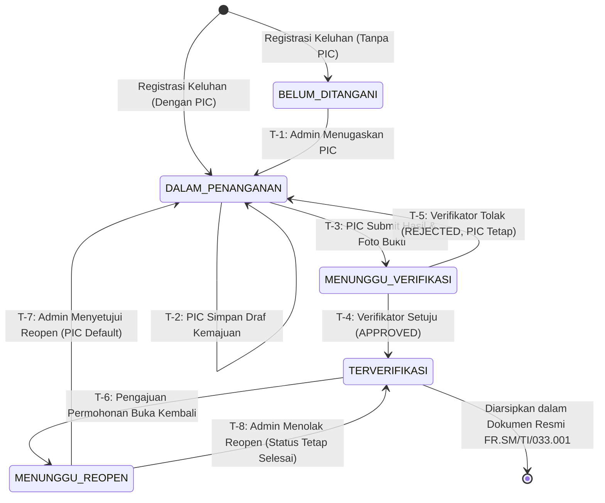

# Spesifikasi Finite State Machine (FSM) Keluhan SPKP
**PT Kereta Api Indonesia (Persero)**

> **Versi Dokumen:** 1.0.0-Fase2  
> **Status:** Draft Arsitektur & Analisis Bisnis  
> **Tanggal:** 2026-10-10  
> **Tujuan:** Menetapkan seluruh transisi status yang sah, aturan guard, payload validasi, mutasi timestamp, audit trail, serta menangkal transisi ilegal dari input klien.

---

## 1. Diagram Alur Siklus Hidup Keluhan (Mermaid FSM)

---

## 2. Evaluasi Desain: Status Utama vs Entitas Terpisah untuk Reopen

Salah satu keputusan arsitektural krusial adalah bagaimana memodelkan siklus **Permintaan Pembukaan Kembali (Reopen Request)**:

| Parameter Evaluasi | Opsi A: Status Utama di Enum (`MENUNGGU_REOPEN`) | Opsi B: Entitas Terpisah (`ReopenRequest` Model) — **(Rekomendasi)** |
|:---|:---|:---|
| **Struktur Database** | Menambah enum value pada `ComplaintStatus`. | Menjaga enum `ComplaintStatus` tetap bersih 4 status (`BELUM_DITANGANI`, `DALAM_PENANGANAN`, `MENUNGGU_VERIFIKASI`, `TERVERIFIKASI`), dan membuat tabel relasional `ReopenRequest`. |
| **Penyimpanan Alasan & Keputusan** | Butuh kolom tambahan di tabel `Complaint` (misal `reopenReason`, `reopenRequestedBy`, `reopenDecisionNotes`). Jika dibuka berulang kali, data lama tertimpa (*loss of history*). | Setiap permohonan menjadi baris rekaman tersendiri lengkap dengan timestamp pengajuan, pemohon, keputusan Admin, dan histori audit. |
| **Konsistensi Kode Aktual** | Memerlukan perubahan tipe TypeScript, filter dashboard, dan tab status di seluruh `DashboardClient.tsx`. | Status keluhan tetap `TERVERIFIKASI`, namun memiliki badge reaktif *"Dalam Permohonan Buka Kembali"* jika ada relasi `ReopenRequest` dengan status `PENDING`. UI hanya menambah panel peninjauan untuk Admin. |
| **Dukungan Audit ISO/KAI** | Kurang ideal karena tidak memiliki jejak audit permohonan berulang. | **Sangat Sesuai Standar Audit KAI/ISO**: Seluruh riwayat pengajuan, penolakan, dan persetujuan terdokumentasi rapi tanpa menimpa data pokok. |

> **Rekomendasi Arsitektur:** **Opsi B (Entitas `ReopenRequest` Terpisah)** didukung dengan flag/relasi aktif. Untuk keperluan state machine konseptual, status operasional sementara ini kita sebut sebagai sub-status `MENUNGGU_REOPEN` (atau state request: `PENDING_ADMIN_REVIEW`).

---

## 3. Matriks Detail Transisi State Machine

Setiap transisi status diwajibkan melewati proteksi Server Action di backend dan dilarang keras diubah secara langsung oleh payload klien (*tamper-proof*).

---

### Transisi T-1: Penugasan PIC Awal
* **Status Awal:** `BELUM_DITANGANI`
* **Status Tujuan:** `DALAM_PENANGANAN`
* **Role yang Diizinkan:** Hanya `ADMIN`
* **Validasi Prasyarat:**
  * Keluhan terdaftar di sistem dan saat ini belum memiliki PIC (`picId === null`).
  * `targetPicId` harus valid, merujuk pada pengguna yang terdaftar dengan role `PIC` atau `ADMIN`.
* **Data yang Harus Diisi:** `picId: string`
* **Timestamp yang Dimutakhirkan:** `updatedAt = now()`
* **Audit Trail / Riwayat:** Log penugasan PIC dicatat (bisa diperluas ke tabel audit log aktivitas).
* **Kode & Pesan Error:**
  * `403 FORBIDDEN`: `"Hanya Admin yang berwenang menentukan penugasan PIC."`
  * `400 BAD_REQUEST`: `"Petugas PIC yang dipilih tidak valid atau tidak aktif."`
  * `409 CONFLICT`: `"Status keluhan saat ini tidak mengizinkan penugasan awal (harus BELUM_DITANGANI)."`

---

### Transisi T-2: Penyimpanan Draf Kemajuan Penanganan
* **Status Awal:** `DALAM_PENANGANAN`
* **Status Tujuan:** `DALAM_PENANGANAN` (status tidak berubah)
* **Role yang Diizinkan:** Khusus `PIC` yang ditugaskan (`complaint.picId === user.id`) atau `ADMIN` (override).
* **Validasi Prasyarat:**
  * Minimal salah satu dari tindakan perbaikan (`correctiveAction`), tindakan pencegahan (`preventiveAction`), catatan (`notes`), atau URL foto (`proofImageUrl`) terisi.
* **Data yang Dimutakhirkan:** Bidang tindakan yang diisi disimpan secara parsial (*autosave/draft*).
* **Timestamp yang Dimutakhirkan:** `updatedAt = now()`
* **Audit Trail / Riwayat:** Mutasi data draf penanganan.
* **Kode & Pesan Error:**
  * `403 FORBIDDEN`: `"Akses ditolak. Anda hanya berwenang mengeksekusi keluhan yang ditugaskan kepada Anda."`
  * `400 BAD_REQUEST`: `"Formulir tindakan penanganan tidak boleh kosong."`

---

### Transisi T-3: Pengajuan Hasil Penanganan untuk Verifikasi
* **Status Awal:** `DALAM_PENANGANAN`
* **Status Tujuan:** `MENUNGGU_VERIFIKASI`
* **Role yang Diizinkan:** Khusus `PIC` yang ditugaskan (`complaint.picId === user.id`)
* **Validasi Prasyarat:**
  1. `correctiveAction` wajib diisi dan minimal 10 karakter.
  2. `preventiveAction` wajib diisi dan minimal 10 karakter.
  3. `proofImageUrl` wajib terisi (URL gambar Cloudinary yang valid).
* **Data yang Harus Diisi:** Payload penanganan lengkap beserta foto bukti.
* **Timestamp yang Dimutakhirkan:**
  * `submittedAt = now()` (titik henti waktu penanganan PIC untuk kalkulasi SLA)
  * `updatedAt = now()`
* **Audit Trail / Riwayat:** Pengajuan diverifikasi dicatat; riwayat penanganan tersimpan.
* **Kode & Pesan Error:**
  * `403 FORBIDDEN`: `"Akses ditolak. Anda tidak berhak mengajukan verifikasi untuk keluhan ini."`
  * `422 UNPROCESSABLE_ENTITY`: `"Tindakan perbaikan, pencegahan, dan foto bukti lapangan wajib lengkap sebelum diajukan ke verifikator."`
  * `409 CONFLICT`: `"Keluhan tidak berada dalam status DALAM_PENANGANAN."`

---

### Transisi T-4: Verifikator Menyetujui Hasil Penanganan (APPROVED)
* **Status Awal:** `MENUNGGU_VERIFIKASI`
* **Status Tujuan:** `TERVERIFIKASI`
* **Role yang Diizinkan:** Mutlak hanya `VERIFIKATOR` (Admin dan PIC dilarang keras).
* **Validasi Prasyarat:**
  * Keluhan wajib sedang dalam status `MENUNGGU_VERIFIKASI`.
  * Verifikator wajib menginput kesimpulan hasil verifikasi (`feedback`) secara manual (minimal 5 karakter, tidak boleh teks kosong).
* **Data yang Harus Diisi:**
  * `result: "APPROVED"`
  * `feedback: string`
* **Timestamp yang Dimutakhirkan:**
  * `updatedAt = now()`
  * `Verification.verifiedAt = now()`
* **Audit Trail / Riwayat:** Baris baru dibuat di tabel `Verification`:
  `{ complaintId, verifierId, result: 'APPROVED', feedback, verifiedAt }`
* **Kode & Pesan Error:**
  * `403 FORBIDDEN`: `"Hanya Verifikator yang berwenang melakukan verifikasi mutu keluhan (SOP KAI four-eyes principle)."`
  * `422 UNPROCESSABLE_ENTITY`: `"Kesimpulan hasil verifikasi wajib diisi."`
  * `409 CONFLICT`: `"Keluhan belum diajukan oleh PIC atau sudah tidak dalam status MENUNGGU_VERIFIKASI."`

---

### Transisi T-5: Verifikator Menolak Hasil Penanganan (REJECTED)
* **Status Awal:** `MENUNGGU_VERIFIKASI`
* **Status Tujuan:** `DALAM_PENANGANAN`
* **Role yang Diizinkan:** Mutlak hanya `VERIFIKATOR` (Admin dan PIC dilarang keras).
* **Validasi Prasyarat:**
  * Keluhan wajib sedang dalam status `MENUNGGU_VERIFIKASI`.
  * Alasan penolakan (`feedback`) wajib diisi secara rinci menjelaskan apa yang harus diperbaiki PIC (minimal 10 karakter).
* **Data yang Dimutakhirkan:**
  * `status = DALAM_PENANGANAN`
  * `picId` **TETAP SAMA** (tidak diubah atau dikosongkan).
  * Catatan tindakan PIC sebelumnya **TIDAK DIHAPUS** (agar PIC dapat menyempurnakan, bukan mengetik ulang dari nol).
* **Timestamp yang Dimutakhirkan:**
  * `updatedAt = now()`
  * `Verification.verifiedAt = now()`
* **Audit Trail / Riwayat:** Baris baru dibuat di tabel `Verification` dengan `result: 'REJECTED'` dan rekaman alasan penolakan.
* **Kode & Pesan Error:**
  * `403 FORBIDDEN`: `"Hanya Verifikator yang berwenang menolak verifikasi keluhan."`
  * `422 UNPROCESSABLE_ENTITY`: `"Alasan penolakan dan instruksi perbaikan wajib diisi secara jelas."`
  * `409 CONFLICT`: `"Keluhan tidak dalam status MENUNGGU_VERIFIKASI."`

---

### Transisi T-6: Pengajuan Permohonan Pembukaan Kembali (Reopen Request)
* **Status Awal:** `TERVERIFIKASI`
* **Status Operasional / Sub-Status:** `MENUNGGU_REOPEN` (Status pokok tetap `TERVERIFIKASI` dengan entitas permohonan `ReopenRequest: PENDING`)
* **Role yang Diizinkan:** Pengguna yang diberi hak akses (Keputusan #4 yang perlu konfirmasi: Rekomendasi = `VERIFIKATOR` dan `ADMIN`, atau pelapor via CS).
* **Validasi Prasyarat:**
  * Keluhan wajib sudah berstatus `TERVERIFIKASI`.
  * Tidak sedang memiliki permohonan reopen lain yang masih berstatus pending.
  * Alasan pembukaan kembali (`reason`) wajib diisi secara komprehensif (minimal 15 karakter).
* **Data yang Harus Diisi:**
  * `complaintId: string`
  * `reason: string`
  * `requestedById: string`
* **Timestamp yang Dimutakhirkan:** `ReopenRequest.requestedAt = now()`
* **Audit Trail / Riwayat:** Rekor permohonan baru tercatat di entitas `ReopenRequest`.
* **Kode & Pesan Error:**
  * `400 BAD_REQUEST`: `"Alasan pembukaan kembali keluhan wajib diisi lengkap."`
  * `409 CONFLICT`: `"Hanya keluhan yang telah TERVERIFIKASI yang dapat diajukan untuk dibuka kembali."`
  * `409 CONFLICT`: `"Permohonan pembukaan kembali untuk keluhan ini sedang menunggu peninjauan Admin."`

---

### Transisi T-7: Admin Menyetujui Pembukaan Kembali Keluhan
* **Status Awal:** `TERVERIFIKASI` (dengan permohonan reopen pending)
* **Status Tujuan:** `DALAM_PENANGANAN`
* **Role yang Diizinkan:** Mutlak hanya `ADMIN`
* **Validasi Prasyarat:**
  * Terdapat permohonan pembukaan kembali berstatus pending untuk keluhan ini.
  * Admin wajib menyertakan catatan persetujuan (`adminNotes`).
* **Data yang Dimutakhirkan:**
  * `status = DALAM_PENANGANAN`
  * `picId` **Secara default tetap ditugaskan ke PIC sebelumnya** (Admin memiliki opsi menunjuk PIC baru jika petugas sebelumnya berhalangan).
  * `ReopenRequest.status = 'APPROVED'`
  * `ReopenRequest.reviewedById = user.id`
  * `ReopenRequest.reviewedAt = now()`
* **Timestamp yang Dimutakhirkan:** `updatedAt = now()`
* **Audit Trail / Riwayat:** Riwayat persetujuan reopen tercatat lengkap.
* **Kode & Pesan Error:**
  * `403 FORBIDDEN`: `"Hanya Admin yang berwenang menyetujui pembukaan kembali keluhan."`
  * `404 NOT_FOUND`: `"Tidak ditemukan permohonan pembukaan kembali yang aktif untuk keluhan ini."`

---

### Transisi T-8: Admin Menolak Pembukaan Kembali Keluhan
* **Status Awal:** `TERVERIFIKASI` (dengan permohonan reopen pending)
* **Status Tujuan:** `TERVERIFIKASI` (status tidak berubah)
* **Role yang Diizinkan:** Mutlak hanya `ADMIN`
* **Validasi Prasyarat:**
  * Terdapat permohonan pembukaan kembali berstatus pending.
  * Admin wajib menyertakan alasan penolakan permohonan (`adminNotes`).
* **Data yang Dimutakhirkan:**
  * `status = TERVERIFIKASI` (tetap terkunci)
  * `ReopenRequest.status = 'REJECTED'`
  * `ReopenRequest.reviewedById = user.id`
  * `ReopenRequest.reviewedAt = now()`
  * `ReopenRequest.adminNotes = string`
* **Timestamp yang Dimutakhirkan:** `updatedAt = now()`
* **Audit Trail / Riwayat:** Riwayat penolakan reopen tercatat di `ReopenRequest`.
* **Kode & Pesan Error:**
  * `403 FORBIDDEN`: `"Hanya Admin yang berwenang menolak permohonan pembukaan kembali."`
  * `422 UNPROCESSABLE_ENTITY`: `"Alasan penolakan pembukaan kembali wajib diisi."`

---

## 4. Matriks Transisi Ringkas (State Transition Table)

| Status Asal | Aksi / Event | Role Pelaksana | Status Tujuan | Guard / Validasi Kunci |
|:---|:---|:---|:---|:---|
| **BELUM_DITANGANI** | Tugaskan PIC | `ADMIN` | `DALAM_PENANGANAN` | `picId` valid |
| **DALAM_PENANGANAN** | Simpan Draf | `PIC` (Assigned) | `DALAM_PENANGANAN` | Minimal 1 data tindakan terisi |
| **DALAM_PENANGANAN** | Ajukan Verifikasi | `PIC` (Assigned) | `MENUNGGU_VERIFIKASI` | Corrective + Preventive + Foto Bukti lengkap |
| **MENUNGGU_VERIFIKASI** | Setujui Penanganan | `VERIFIKATOR` | `TERVERIFIKASI` | Feedback persetujuan wajib diisi |
| **MENUNGGU_VERIFIKASI** | Tolak Penanganan | `VERIFIKATOR` | `DALAM_PENANGANAN` | Feedback alasan penolakan wajib diisi, PIC tetap |
| **TERVERIFIKASI** | Ajukan Reopen | *Perlu Konfirmasi* | `TERVERIFIKASI` (*Pending Reopen*) | Status wajib TERVERIFIKASI, alasan wajib diisi |
| *Pending Reopen* | Setujui Reopen | `ADMIN` | `DALAM_PENANGANAN` | Default PIC sebelumnya |
| *Pending Reopen* | Tolak Reopen | `ADMIN` | `TERVERIFIKASI` | Alasan penolakan wajib diisi |

---

## 5. Larangan Transisi Ilegal (Invariants & Anti-Patterns)

1. **Dilarang Self-Verification:** PIC dilarang mengubah status dari `MENUNGGU_VERIFIKASI` ke `TERVERIFIKASI`.
2. **Dilarang Admin-Verification:** Admin dilarang menyetujui/menolak verifikasi langsung melewati Verifikator.
3. **Dilarang Jump Transitions:**
   * Tidak boleh dari `BELUM_DITANGANI` langsung ke `MENUNGGU_VERIFIKASI` atau `TERVERIFIKASI`.
   * Tidak boleh dari `DALAM_PENANGANAN` langsung ke `TERVERIFIKASI` tanpa melalui verifikator.
4. **Dilarang Direct Reopen:** Tidak ada pengguna yang dapat langsung mengubah `TERVERIFIKASI` menjadi `DALAM_PENANGANAN` tanpa proses persetujuan resmi Admin.
